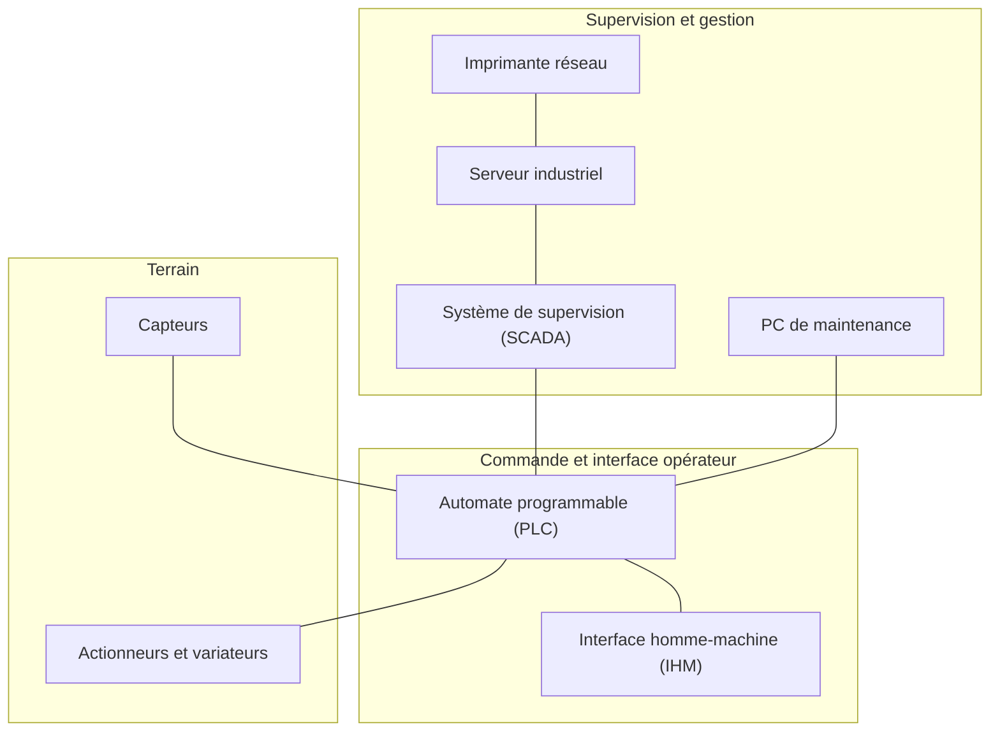

import Tabs from '@theme/Tabs';
import TabItem from '@theme/TabItem';

# Les réseaux informatiques

## Qu'est-ce qu'un réseau informatique ?

Un réseau informatique est un ensemble d'équipements connectés entre eux afin de permettre l'échange d'informations.

Ces équipements peuvent être :

Les équipements connectés à un réseau informatique ou industriel peuvent être très variés :

- **Ordinateurs :** un PC utilisé par un technicien de maintenance pour programmer un automate ou consulter les données d'une installation.
- **Serveurs :** un serveur hébergeant une base de données contenant les mesures de production ou les historiques d'alarmes d'une installation.
- **Imprimantes :** une imprimante réseau permettant d'imprimer les rapports de production ou les fiches de maintenance.
- **Automates programmables (PLC) :** un automate Siemens S7-1200 pilotant une machine et échangeant des données avec une IHM ou un système de supervision.
- **Interfaces homme-machine (IHM) :** un écran Siemens KTP700 permettant à un opérateur de visualiser les mesures, de modifier des consignes et de commander une machine.
- **Capteurs et actionneurs communicants :** un capteur de température IO-Link transmettant une mesure à un automate, ou un variateur de vitesse communicant recevant une consigne de vitesse.
- **Systèmes de supervision (SCADA) :** un logiciel permettant à un opérateur de surveiller une ligne de production, de consulter les alarmes et de suivre les paramètres de fonctionnement des machines.

La connexion et la communication entre les équipements peuvent être réalisées de différentes manières.

Les équipements d'un réseau industriel peuvent être regroupés selon leur rôle dans l'installation. Certains permettent de surveiller et de gérer la production, d'autres assurent la commande des machines ou sont directement associés au procédé industriel.

### Supports physiques de transmission

- **Câbles Ethernet (cuivre) :** utilisés pour connecter des ordinateurs, des automates, des IHM et des équipements réseau.
- **Fibres optiques :** utilisées pour transmettre des données sur de longues distances ou dans des environnements soumis à des perturbations électromagnétiques.
- **Liaisons sans fil :** Wi-Fi ou autres technologies radio, notamment pour connecter des équipements mobiles ou difficiles à câbler.

### Technologies de communication industrielles

Dans l'industrie, plusieurs technologies spécifiques sont utilisées pour permettre aux équipements de communiquer :

- **Bus de terrain :** CAN, PROFIBUS, Modbus RTU.
- **Ethernet industriel :** PROFINET, Modbus TCP, EtherNet/IP.
- **Communication point-à-point :** IO-Link, utilisé notamment pour communiquer avec des capteurs et des actionneurs.

Ces technologies définissent les règles d'échange des données entre les équipements. Elles peuvent utiliser différents supports physiques selon leur conception.

:::info Définition
Un réseau informatique permet à plusieurs équipements de communiquer et de partager des informations ou des ressources.
:::

### Exemple : communication dans une installation industrielle

Considérons une installation industrielle dans laquelle un automate commande une machine et transmet des informations à un système de supervision.

Les données circulent entre plusieurs équipements :

1. Un capteur mesure la température d'un procédé industriel.
2. Le capteur transmet sa mesure à l'automate, par l'intermédiaire d'une entrée analogique ou d'un système de communication industriel (par exemple IO-Link).
3. L'automate traite cette information et commande les équipements de la machine.
4. L'automate transmet les informations nécessaires au système de supervision via un réseau Ethernet industriel.
5. Le système de supervision affiche la température et l'état de la machine à l'opérateur.

On peut représenter cette communication de manière simplifiée :

Cet exemple illustre que plusieurs technologies de communication peuvent être utilisées dans une même installation industrielle.

## Quelques caractéristiques d'un réseau

Plusieurs caractéristiques permettent de décrire les performances d'un réseau. Trois d'entre elles sont particulièrement importantes : le débit, la latence et la fiabilité.

### Le débit

Le débit représente la quantité de données pouvant être transmise pendant une durée donnée.

Il est généralement exprimé en bits par seconde (bit/s).

Quelques unités courantes :

| Unité | Signification |
|---|---|
| kbit/s | 1 000 bits/s |
| Mbit/s | 1 000 000 bits/s |
| Gbit/s | 1 000 000 000 bits/s |

Exemple :

Une liaison Ethernet de 100 Mbit/s peut théoriquement transmettre 100 millions de bits par seconde.

:::info Bit et octet
Un bit représente une information binaire pouvant prendre la valeur 0 ou 1.

Un octet (byte) correspond à un ensemble de 8 bits.

Attention à ne pas confondre :

- Mbit/s : mégabits par seconde.
- Mo/s : mégaoctets par seconde.

**1 Mo/s correspond à 8 Mbit/s.**
:::

:::note Débit théorique et débit réel
Le débit théorique d'une liaison ne correspond pas nécessairement au débit réellement disponible pour les applications.

Les protocoles réseau, les informations de contrôle et les autres communications utilisent également une partie de la capacité disponible.
:::

### La latence

La latence correspond au temps nécessaire pour qu'une donnée atteigne sa destination.

Elle est généralement exprimée en millisecondes (ms).

Exemple :

Un automate envoie une information à un système de supervision. Si cette information met 20 ms pour arriver à destination, la latence de transmission est de 20 ms.

:::warning À ne pas confondre
Le débit et la latence représentent deux caractéristiques différentes :

- Le débit indique la quantité de données pouvant être transmise par seconde.
- La latence indique le temps nécessaire pour transmettre une donnée.
:::

### La fiabilité

La fiabilité représente la capacité du réseau à fonctionner correctement et à transmettre les informations sans interruption ou erreur.

Dans une installation industrielle, une perte de communication peut entraîner :

- Une perte de supervision.
- Une impossibilité de commander certains équipements.
- Un arrêt de production.
- Dans certains cas, une situation dangereuse.

:::tip À retenir
Un réseau industriel ne doit pas seulement être rapide. Il doit également être fiable et adapté aux contraintes de l'application.
:::