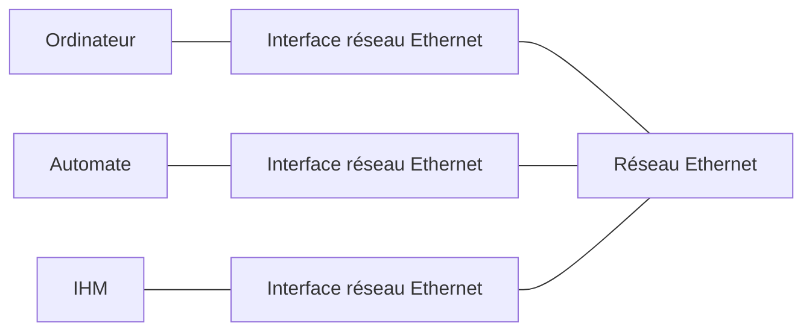
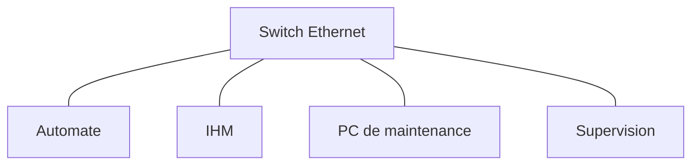
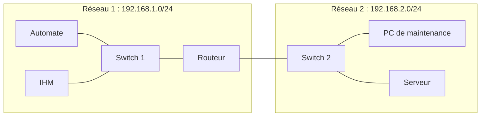

import Tabs from '@theme/Tabs';
import TabItem from '@theme/TabItem';

# Les principaux équipements réseau

## La carte réseau

Chaque équipement connecté à un réseau Ethernet possède généralement une interface réseau.

Cette interface permet d'envoyer et de recevoir des données.

Elle possède notamment une adresse physique appelée **adresse MAC**.

**Exemple :**

Un ordinateur, un automate Siemens ou une IHM peuvent tous posséder une interface Ethernet.

On peut représenter cette interface comme le point de connexion entre un équipement et le réseau :

:::info Adresse MAC
L'adresse MAC (*Media Access Control*) est une adresse physique utilisée pour identifier une interface réseau au niveau Ethernet.

Elle est généralement représentée sous la forme de six groupes de deux caractères hexadécimaux.

Exemple : `00:1A:2B:3C:4D:5E`
:::

La notion d'adresse MAC sera approfondie lors de l'étude du modèle OSI.

## Le switch (commutateur)

Un switch permet de connecter plusieurs équipements au sein d'un même réseau local.

Il reçoit les trames Ethernet et les transmet vers le port correspondant à l'équipement destinataire.

Pour effectuer cette opération, il apprend et utilise les adresses MAC des équipements connectés.

### Exemple industriel

Un switch Ethernet peut connecter :

- Un automate programmable.
- Une IHM.
- Un ordinateur de maintenance.
- Un système de supervision.

Ces équipements peuvent alors communiquer entre eux.

:::tip À retenir
Le switch permet principalement de connecter plusieurs équipements au sein d'un même réseau local.

Il utilise les adresses MAC pour transmettre les trames Ethernet vers leur destination.
:::

## Le routeur

Un routeur permet de faire communiquer plusieurs réseaux IP différents.

Il examine l'adresse IP de destination et détermine vers quel réseau transmettre les paquets.

Le routeur possède une interface réseau associée à chacun des réseaux qu'il relie. Ces interfaces lui permettent de recevoir les paquets d'un réseau et de les transmettre vers un autre.

### Exemple industriel

Une installation industrielle possède deux réseaux :

- Réseau 1 : `192.168.1.0/24`
- Réseau 2 : `192.168.2.0/24`

Un routeur peut permettre la communication entre ces deux réseaux.

Dans une installation réelle, les équipements sont généralement raccordés à un switch, lui-même connecté au routeur.

:::tip À retenir
Le routeur permet de faire communiquer des réseaux IP différents.

Il utilise les adresses IP pour déterminer vers quel réseau transmettre les paquets.
:::

## Différence entre switch et routeur

| Équipement | Fonction principale | Information utilisée |
|---|---|---|
| Switch | Connecter des équipements dans un réseau local | Adresse MAC |
| Routeur | Faire communiquer plusieurs réseaux IP | Adresse IP |

Un switch et un routeur peuvent être présents simultanément dans une installation industrielle.

:::info Communication locale et communication entre réseaux
Deux équipements appartenant au même réseau local peuvent généralement communiquer à travers un switch, sans passer par un routeur.

En revanche, lorsque deux équipements appartiennent à des réseaux IP différents, un routeur est nécessaire pour assurer la communication entre ces réseaux.
:::
