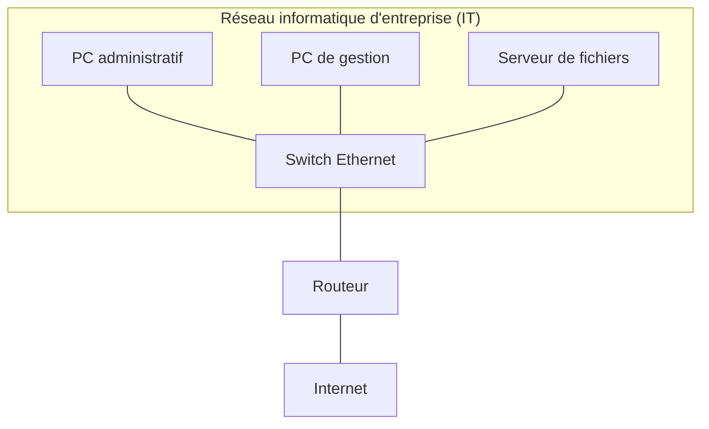
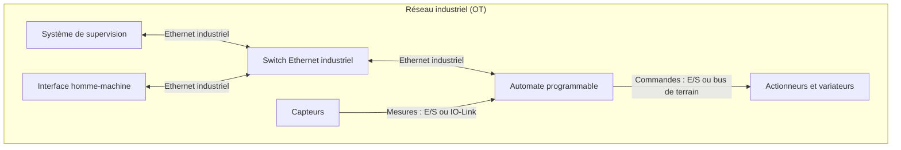
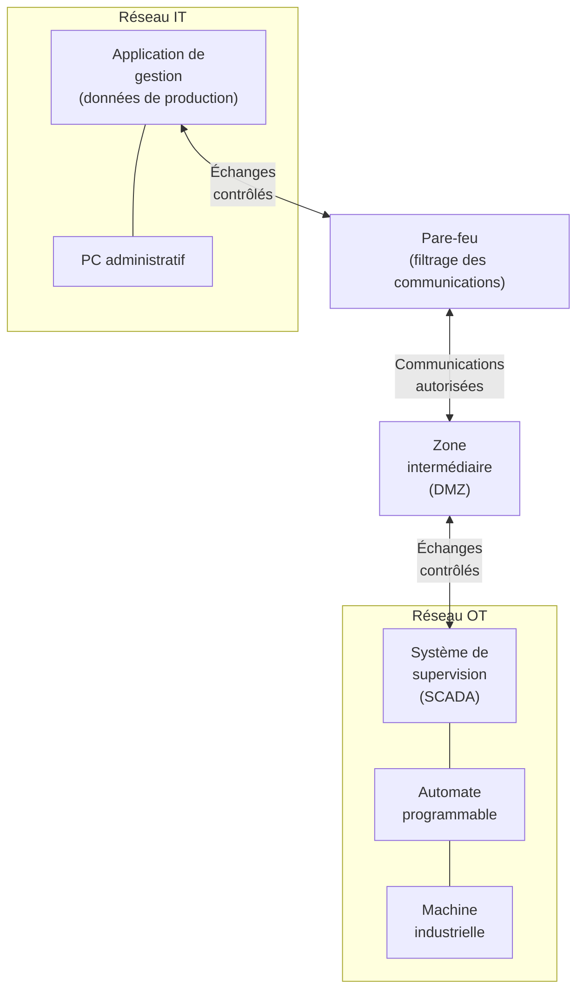

import Tabs from '@theme/Tabs';
import TabItem from '@theme/TabItem';

# Les réseaux industriels

## Les réseaux informatiques classiques (IT)

Les réseaux IT (*Information Technology*) sont principalement utilisés pour transporter et traiter des informations informatiques.

**Exemples :**

- Réseau informatique d'une entreprise.
- Serveurs de fichiers.
- Messagerie électronique.
- Applications de gestion.
- Accès à Internet.

Les performances sont généralement évaluées en fonction du débit, de la disponibilité et de la qualité du service.

Une latence de quelques dizaines de millisecondes est souvent acceptable pour de nombreuses applications bureautiques.

### Exemple d'un réseau IT

Dans une entreprise, un réseau informatique classique peut permettre aux employés d'accéder à des serveurs, à des applications de gestion et à Internet.

:::info IT : Information Technology
Les réseaux IT sont principalement orientés vers les échanges d'informations et l'accès aux applications informatiques utilisées par les employés d'une entreprise.
:::

## Les réseaux industriels (OT)

Les réseaux OT (*Operational Technology*) sont utilisés pour surveiller et contrôler des équipements physiques.

**Exemples :**

- **Automates programmables (PLC) :** Siemens S7-1200 utilisé pour commander une machine automatisée.
- **Capteurs industriels :** capteur de température mesurant la température d'un four industriel ou capteur de proximité détectant la présence d'une pièce sur un convoyeur.
- **Variateurs de vitesse :** variateur Siemens SINAMICS G120 permettant de contrôler la vitesse de rotation d'un moteur électrique.
- **Robots industriels :** robot ABB IRB 1200 réalisant des opérations de manipulation ou d'assemblage.
- **Systèmes de supervision (SCADA) :** logiciel WinCC permettant de surveiller une ligne de production, d'afficher les mesures et de consulter les alarmes.
- **Machines automatisées :** convoyeur motorisé, machine de conditionnement ou cellule robotisée pilotée par un automate.

Ils permettent notamment :

- La transmission des mesures des capteurs.
- L'envoi de commandes aux actionneurs.
- La communication entre automates.
- La supervision des installations.
- Le diagnostic des équipements.

Dans un environnement industriel, les communications doivent parfois respecter des contraintes de temps très strictes. Une commande doit, par exemple, être transmise à un actionneur dans un délai suffisamment court et prévisible pour assurer le bon fonctionnement de la machine.

### Exemple d'un réseau OT

Dans une installation industrielle, les capteurs transmettent des mesures à un automate. Celui-ci traite les informations et commande les actionneurs. Un système de supervision permet à un opérateur de surveiller le fonctionnement de l'installation.

:::info OT : Operational Technology
Les réseaux OT sont principalement orientés vers la surveillance et le contrôle de processus physiques : machines, lignes de production, installations automatisées, etc.
:::

:::info À retenir
Un bus de terrain permet de transporter des informations entre les équipements industriels.

Ces informations peuvent être des mesures provenant des capteurs ou des commandes destinées aux actionneurs.
:::

:::tip À retenir
Dans un réseau OT, les communications ne servent pas uniquement à échanger des informations : elles peuvent directement influencer le fonctionnement d'une machine ou d'un procédé industriel.
:::

## Différences entre IT et OT

Les réseaux IT et OT répondent à des besoins différents, même s'ils utilisent parfois des technologies communes, comme Ethernet et TCP/IP.

| Critère | Réseau IT | Réseau OT |
|---|---|---|
| Objectif principal | Transporter et traiter des informations | Contrôler et surveiller des processus physiques |
| Équipements | PC, serveurs, imprimantes | Automates, capteurs, variateurs, IHM |
| Priorités | Confidentialité, intégrité et disponibilité des données | Disponibilité, intégrité et sûreté de fonctionnement |
| Temps de réponse | Généralement moins contraignant | Peut être très contraignant |
| Interruptions | Souvent tolérées temporairement | Peuvent entraîner un arrêt de production |
| Durée de vie des équipements | Renouvellement relativement fréquent | Équipements parfois conservés pendant de nombreuses années |

:::warning Attention aux différences IT / OT
Ces différences représentent des tendances générales.

La disponibilité et la sécurité sont importantes dans les deux environnements. Toutefois, une interruption du réseau OT peut directement perturber une production ou affecter la sécurité des personnes et des installations.
:::

### Communication entre IT et OT

Les réseaux IT et OT ne sont pas nécessairement totalement isolés. Des échanges peuvent être nécessaires pour transmettre des informations de production, consulter des indicateurs ou alimenter des applications de gestion.

Ces échanges doivent cependant être contrôlés et sécurisés.

On peut représenter cette communication de manière simplifiée :

:::info DMZ (*Demilitarized Zone*)
Une DMZ est une zone intermédiaire entre le réseau IT et le réseau OT. Elle permet de contrôler et de sécuriser les échanges entre ces deux réseaux, sans les mettre directement en communication.

Par exemple, un serveur placé dans la DMZ peut récupérer les données de production du réseau OT et les mettre à disposition d'une application de gestion du réseau IT.

La DMZ joue le rôle de zone tampon entre les réseaux IT et OT.
:::

*Ce schéma illustre un principe d'architecture possible. Dans une installation réelle, les échanges entre IT et OT peuvent être organisés de différentes manières, avec plusieurs mécanismes de filtrage et de contrôle.*

:::tip À retenir
Les réseaux IT et OT peuvent communiquer, mais leurs échanges doivent être maîtrisés afin de ne pas compromettre le fonctionnement de l'installation industrielle.

La segmentation et la sécurisation des réseaux industriels seront étudiées plus en détail dans la partie consacrée à la cybersécurité industrielle.
:::