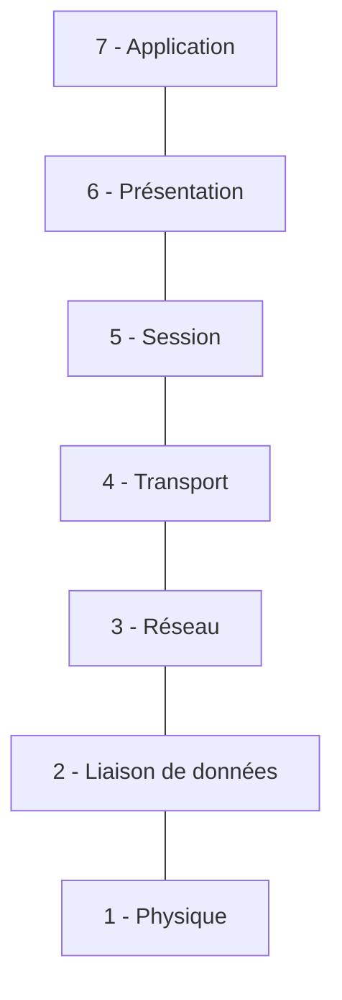
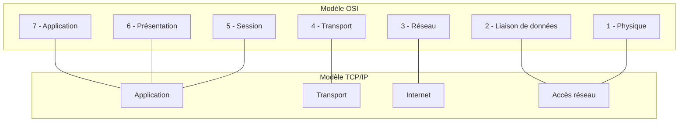

import Tabs from '@theme/Tabs';
import TabItem from '@theme/TabItem';

# Les modèles de communication OSI et TCP/IP

## Pourquoi utiliser un modèle de communication ?

Lorsque deux équipements communiquent, ils doivent respecter des règles communes.

Ces règles définissent notamment :

- La manière de transmettre les données.
- La manière d'identifier les équipements.
- La manière de découper les informations.
- La manière de détecter certaines erreurs.
- La manière de retrouver les données reçues.

Pour faciliter la compréhension de ces mécanismes, les communications réseau sont organisées en différentes couches.

Chaque couche possède un rôle particulier et s'appuie sur les services des couches inférieures.

Deux modèles sont particulièrement connus :

- Le modèle OSI.
- Le modèle TCP/IP.

## Le modèle OSI

Le modèle OSI (*Open Systems Interconnection*) est un modèle de référence qui décrit les communications réseau à l'aide de sept couches.

Chaque couche possède une fonction précise.

### Les sept couches du modèle OSI

| Couche | Nom | Fonction principale | Exemple |
|---:|---|---|---|
| 7 | Application | Services utilisés par les applications | HTTP, Modbus TCP, OPC UA |
| 6 | Présentation | Format et représentation des données | Encodage, chiffrement |
| 5 | Session | Gestion des échanges entre applications | Gestion de session |
| 4 | Transport | Transport des données entre applications | TCP, UDP |
| 3 | Réseau | Adressage logique et routage | IPv4 |
| 2 | Liaison de données | Communication sur le réseau local | Ethernet, adresse MAC |
| 1 | Physique | Transmission des bits | Câble, fibre optique |

On peut représenter les sept couches sous la forme d'une pile :



:::info Principe des couches
Chaque couche assure une fonction particulière dans la communication.

Cette organisation permet de séparer les différents mécanismes nécessaires à l'échange de données et de faciliter la conception des réseaux.
:::

### Explication des couches

**Couche 1 – Physique**

Elle concerne la transmission des bits sur un support physique.

Exemples :

- Câble Ethernet.
- Fibre optique.
- Connecteurs.
- Signaux électriques ou optiques.

**Couche 2 – Liaison de données**

Elle organise les données en trames et permet la communication sur un réseau local.

Elle utilise notamment les adresses MAC pour identifier les interfaces réseau.

Exemple : Ethernet.

**Couche 3 – Réseau**

Elle permet d'identifier les réseaux et de faire circuler les données entre plusieurs réseaux.

Elle utilise des adresses logiques pour identifier les équipements et déterminer le chemin à suivre.

Exemple : IPv4.

**Couche 4 – Transport**

Elle permet de transporter les données entre les applications de deux équipements.

Deux protocoles importants :

- **TCP :** assure un transport fiable avec contrôle de séquence, détection des pertes et retransmission des données si nécessaire.
- **UDP :** transporte les données sans établissement de connexion et sans mécanisme de retransmission au niveau transport.

**Couches 5 à 7 – Session, Présentation et Application**

Ces trois couches concernent les échanges entre applications et la manière dont les informations sont organisées et utilisées.

Quelques exemples de fonctions :

- **Session :** organisation et gestion des échanges entre applications.
- **Présentation :** représentation, encodage ou chiffrement des données.
- **Application :** services de communication utilisés par les logiciels.

Exemples de protocoles applicatifs :

- HTTP pour les applications Web.
- Modbus TCP pour les échanges de données industrielles.
- OPC UA pour les échanges de données entre systèmes industriels.

:::tip À retenir
Pour une première approche, il est surtout important de comprendre le rôle général des sept couches et de retenir particulièrement les couches 1 à 4.

Elles permettent de comprendre les supports physiques, Ethernet, les adresses IP et les protocoles TCP et UDP.
:::

:::warning Attention
Le modèle OSI est un modèle de référence permettant de comprendre les communications réseau.

Dans la pratique, les protocoles et technologies ne correspondent pas toujours exactement à une seule couche. Certains couvrent plusieurs fonctions.
:::

## Le modèle TCP/IP

Le modèle TCP/IP est plus directement lié aux communications réseau utilisées aujourd'hui.

Il est généralement représenté avec quatre couches.

| Modèle TCP/IP | Correspondance OSI | Exemples |
|---|---|---|
| Application | 5 à 7 | HTTP, Modbus TCP, OPC UA |
| Transport | 4 | TCP, UDP |
| Internet | 3 | IPv4, IPv6 |
| Accès réseau | 1 et 2 | Ethernet, Wi-Fi |

### Correspondance entre les modèles OSI et TCP/IP

Le modèle TCP/IP regroupe certaines couches du modèle OSI.



Le modèle TCP/IP est utilisé dans les réseaux informatiques classiques comme dans de nombreux réseaux industriels.

:::info À retenir
Le modèle OSI comporte sept couches et constitue principalement un modèle de référence.

Le modèle TCP/IP comporte quatre couches et représente plus directement l'organisation des communications utilisées dans les réseaux actuels.
:::

## Principe d'encapsulation

Lorsqu'une application souhaite envoyer une information sur le réseau, cette information traverse les différentes couches de communication.

Chaque couche ajoute des informations nécessaires à la transmission.

C'est le principe de **l'encapsulation**.

### Exemple simplifié

Un ordinateur souhaite envoyer une information à un automate industriel.

1. L'application prépare les données à envoyer.
2. TCP ajoute les informations nécessaires au transport, notamment les ports source et destination.
3. IP ajoute les adresses IP source et destination.
4. Ethernet ajoute les adresses MAC source et destination.
5. Les bits sont transmis sur le support physique.

À la réception, l'opération inverse est réalisée : les informations ajoutées par chaque couche sont interprétées puis retirées.

Cette opération est appelée **désencapsulation**.

### Exemple d'encapsulation : une requête `ping`

La commande `ping` permet de vérifier si un équipement est accessible sur un réseau IP.

Prenons l'exemple d'un ordinateur qui souhaite tester la communication avec un automate industriel situé sur le même réseau local.

**Configuration des équipements :**

| Paramètre | Ordinateur | Automate |
|---|---|---|
| Adresse IPv4 | `192.168.1.20` | `192.168.1.10` |
| Masque de sous-réseau | `255.255.255.0` | `255.255.255.0` |
| Adresse MAC | `00:1A:2B:3C:4D:5E` | `00:11:22:33:44:55` |

L'ordinateur exécute la commande :

```bash
ping 192.168.1.10
```

Il doit alors construire un message ICMP (*Internet Control Message Protocol*) et l'encapsuler dans un paquet IP, lui-même transporté dans une trame Ethernet.

### 1. En-tête Ethernet

L'en-tête Ethernet permet d'identifier les équipements qui communiquent sur le réseau local.

| Champ | Valeur | Signification |
|---|---|---|
| MAC destination | `00:11:22:33:44:55` | Adresse MAC de l'automate |
| MAC source | `00:1A:2B:3C:4D:5E` | Adresse MAC de l'ordinateur |
| EtherType | `0x0800` | Indique que le contenu transporte IPv4 |

L'en-tête Ethernet occupe **14 octets**.

On remarque que l'adresse MAC de destination est celle de l'automate, puisque les deux équipements se trouvent sur le même réseau local.

### 2. En-tête IPv4

Le paquet Ethernet contient ensuite un paquet IPv4.

| Champ | Valeur | Signification |
|---|---|---|
| Version | `4` | Version IPv4 |
| Longueur de l'en-tête | `20 octets` | Taille de l'en-tête IP sans options |
| Adresse IP source | `192.168.1.20` | Adresse de l'ordinateur |
| Adresse IP destination | `192.168.1.10` | Adresse de l'automate |
| TTL | `64` | Nombre maximal de routeurs que le paquet peut traverser |
| Protocole | `1` | Indique que le contenu est un message ICMP |
| Longueur totale | `60 octets` | Taille de l'en-tête IP et des données ICMP |

La valeur du champ **Protocole = 1** indique que le paquet IP transporte directement un message ICMP.

### 3. En-tête ICMP

Le paquet IP contient finalement le message ICMP correspondant à la demande de ping.

| Champ | Valeur | Signification |
|---|---|---|
| Type | `8` | Echo Request : demande de réponse |
| Code | `0` | Code associé à la demande Echo Request |
| Identifiant | `0x0001` | Identifie la requête |
| Numéro de séquence | `1` | Numéro de cette requête |

Le message ICMP contient également des données supplémentaires. Dans cet exemple, elles occupent 32 octets.

Si l'automate accepte de répondre aux requêtes ping, il renvoie un message ICMP de type `0` (*Echo Reply*).

### 4. Représentation de la trame transmise

On peut maintenant représenter l'ensemble des données transmises sur le réseau :

```text
┌──────────────────────────────────────────────┐
│ EN-TÊTE ETHERNET (14 octets)                 │
│                                              │
│ MAC destination : 00:11:22:33:44:55          │
│ MAC source      : 00:1A:2B:3C:4D:5E          │
│ EtherType       : 0x0800 (IPv4)              │
├──────────────────────────────────────────────┤
│ EN-TÊTE IPv4 (20 octets)                     │
│                                              │
│ IP source       : 192.168.1.20               │
│ IP destination  : 192.168.1.10               │
│ TTL             : 64                         │
│ Protocole       : 1 (ICMP)                   │
├──────────────────────────────────────────────┤
│ MESSAGE ICMP (40 octets)                     │
│                                              │
│ Type            : 8 (Echo Request)           │
│ Code            : 0                          │
│ Identifiant     : 0x0001                     │
│ Séquence        : 1                          │
│ Données         : 32 octets                  │
└──────────────────────────────────────────────┘
```

La trame Ethernet contient donc un paquet IP, qui contient lui-même un message ICMP.

Dans cet exemple, la taille totale est de 74 octets, sans compter le contrôle d'intégrité Ethernet (FCS) de 4 octets, qui n'est généralement pas présent dans les captures Wireshark.

:::info À retenir
La commande `ping` utilise ICMP pour tester la communication entre deux équipements.

ICMP est directement transporté par IP : il ne passe donc pas par TCP ou UDP. Il ne possède pas non plus de ports TCP ou UDP.

:::warning Attention aux adresses MAC et IP
Les adresses IP identifient les équipements au niveau réseau, tandis que les adresses MAC permettent d'acheminer les trames sur le réseau local.

Si la destination se trouve sur un autre réseau IP, l'adresse MAC de destination de la trame sera celle de la passerelle par défaut, et non celle de l'équipement distant.
:::


