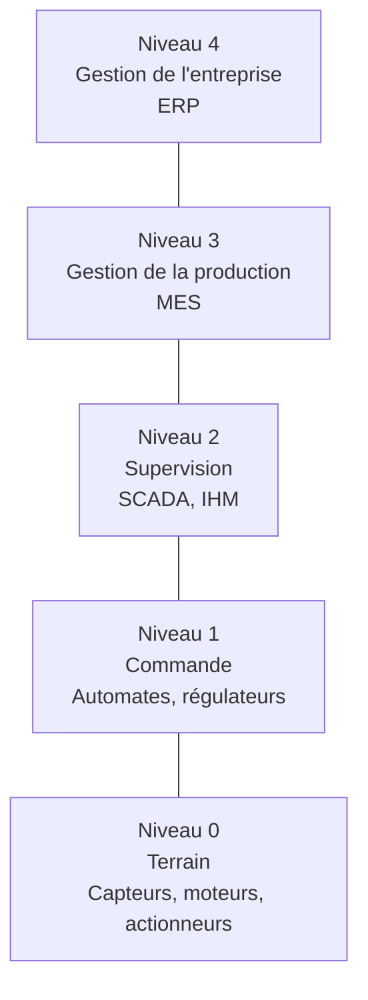
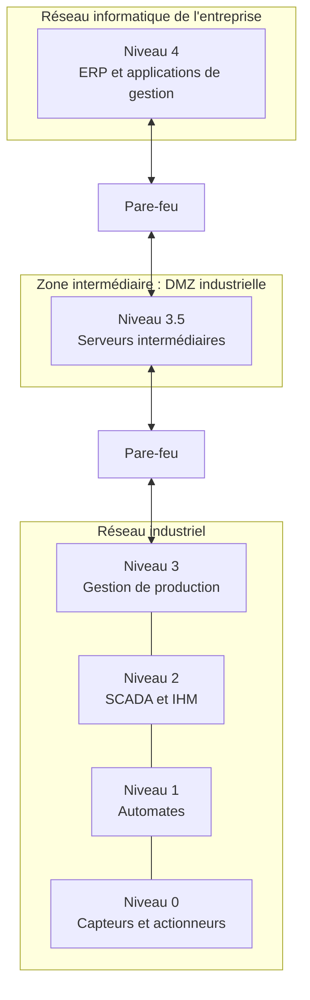

import Tabs from '@theme/Tabs';
import TabItem from '@theme/TabItem';

# Architecture industrielle

## Pourquoi organiser les réseaux industriels en niveaux ?

Dans une installation industrielle, tous les équipements n'ont pas le même rôle.

Un capteur de température ne réalise pas le même travail qu'un automate programmable ou qu'un logiciel de gestion de production.

Pour organiser les fonctions et les communications d'une installation industrielle, on utilise notamment deux modèles :

- La pyramide **CIM**, qui représente les différentes fonctions d'une entreprise industrielle.
- Le modèle **Purdue**, qui sert de référence pour organiser les architectures et les niveaux de communication industriels.

Ces modèles permettent de mieux comprendre comment les équipements de terrain, les systèmes de commande, les outils de supervision et les systèmes informatiques de l'entreprise interagissent.

Nous nous contenteront de décrire la pyramide CIM dans ce cours.

## La pyramide CIM

CIM signifie *Computer Integrated Manufacturing*.

Ce modèle représente l'organisation fonctionnelle d'un système de production industrielle.

Il est généralement présenté en cinq niveaux.

| Niveau | Nom | Fonction | Exemples |
|---:|---|---|---|
| 4 | Gestion de l'entreprise | Gestion globale de l'entreprise | ERP, gestion commerciale, commandes |
| 3 | Gestion de la production | Organisation et suivi de la production | MES, suivi de production |
| 2 | Supervision | Surveillance et conduite du procédé | SCADA, IHM |
| 1 | Commande | Commande et régulation | Automates, régulateurs |
| 0 | Terrain | Interaction avec le procédé physique | Capteurs, moteurs, actionneurs |

### Explication des différents niveaux

**Niveau 0 – Terrain**

Il correspond aux équipements directement en contact avec le procédé industriel.

Exemples :

- Capteur de température.
- Capteur de pression.
- Détecteur de présence.
- Moteur électrique.
- Vérin pneumatique.

**Niveau 1 – Commande**

Il comprend les équipements qui pilotent les installations.

Exemples :

- Automates programmables.
- Régulateurs.
- Commandes de moteurs.

L'automate récupère les informations provenant des capteurs et commande les actionneurs.

**Niveau 2 – Supervision**

Il permet aux opérateurs de surveiller et de commander l'installation.

Exemples :

- Interfaces homme-machine (IHM).
- Systèmes SCADA.
- Postes de conduite.

**Niveau 3 – Gestion de la production**

Il concerne le suivi et l'organisation de la production.

Exemples :

- Gestion des ordres de fabrication.
- Suivi des quantités produites.
- Gestion des performances.
- Systèmes MES (*Manufacturing Execution System*).

**Niveau 4 – Gestion de l'entreprise**

Il concerne la gestion globale de l'entreprise.

Exemples :

- Gestion des commandes.
- Gestion des stocks.
- Gestion des achats.
- Systèmes ERP (*Enterprise Resource Planning*).

### Exemple : ligne de production

Considérons une ligne de production automatisée qui fabrique des pièces métalliques.

1. Un capteur détecte la présence d'une pièce sur un convoyeur (niveau 0).
2. L'automate traite l'information et commande le moteur du convoyeur (niveau 1).
3. L'opérateur visualise l'état de la machine sur une IHM (niveau 2).
4. Le système de production enregistre le nombre de pièces fabriquées et les éventuels arrêts de la ligne (niveau 3).
5. Le système de gestion de l'entreprise exploite les données de production pour gérer les commandes et les stocks (niveau 4).

:::info À retenir
La pyramide CIM décrit principalement les **fonctions** d'une entreprise industrielle, depuis les équipements physiques jusqu'à la gestion globale de l'entreprise.

Elle ne représente pas nécessairement une architecture réseau physique : les échanges réels peuvent être organisés de différentes manières.
:::

{/*
## Introduction au modèle Purdue

Le modèle Purdue est un modèle de référence utilisé pour organiser les architectures des systèmes industriels.

Il distingue différents niveaux, depuis les équipements de terrain jusqu'aux systèmes informatiques de l'entreprise.

Il permet notamment de réfléchir à la séparation des systèmes industriels et des systèmes informatiques classiques.

### Les niveaux du modèle Purdue

On retrouve une organisation en niveaux, proche de celle de la pyramide CIM.

| Niveau | Fonction principale | Exemples |
|---:|---|---|
| 4 | Réseau informatique de l'entreprise | ERP, messagerie, applications de gestion |
| 3 | Gestion et suivi des opérations industrielles | MES, gestion de production |
| 2 | Supervision et conduite du procédé | SCADA, IHM |
| 1 | Commande des équipements | Automates, régulateurs |
| 0 | Procédé physique | Capteurs, moteurs, actionneurs |

Le modèle Purdue est également utilisé pour réfléchir à la séparation des réseaux et à la sécurité des systèmes industriels.

### Représentation simplifiée d'une architecture industrielle

:::info La DMZ industrielle
Une DMZ (*Demilitarized Zone*) est une zone intermédiaire entre le réseau informatique de l'entreprise et le réseau industriel.

Elle permet de contrôler les échanges entre ces deux environnements sans les mettre directement en communication.

Par exemple, un serveur placé dans la DMZ peut récupérer des données de production et les mettre à disposition des applications informatiques de l'entreprise.

La DMZ est souvent représentée au niveau 3.5 dans les architectures inspirées du modèle Purdue. Elle constitue une extension courante du modèle de référence, et non un niveau obligatoire de toutes les installations.
:::

:::warning Attention
La présence d'une DMZ ne garantit pas automatiquement la sécurité des communications.

Les échanges doivent être explicitement autorisés et contrôlés, notamment à l'aide de pare-feu et de règles de filtrage adaptées.
:::

### Différence entre CIM et Purdue

Les deux modèles sont liés, mais ne représentent pas exactement la même chose.

| Modèle CIM | Modèle Purdue |
|---|---|
| Décrit les fonctions d'une entreprise industrielle | Sert de référence pour organiser les architectures industrielles |
| Présente les activités depuis le terrain jusqu'à la gestion de l'entreprise | Distingue les niveaux des systèmes industriels et informatiques |
| Aide à comprendre le rôle des différents systèmes | Aide notamment à organiser les communications et la séparation des réseaux |

:::tip À retenir
- **CIM : quelles sont les fonctions de l'entreprise industrielle ?**
- **Purdue : comment organiser les systèmes et les communications entre ces différents niveaux ?**
:::

---
*/}

# Contraintes spécifiques des réseaux industriels

Les réseaux industriels doivent répondre à des contraintes particulières, notamment en matière de temps de réponse, de prévisibilité et de disponibilité.

## Le temps réel

Dans certaines applications industrielles, une information doit arriver dans un délai déterminé pour permettre au système de réagir correctement.

Exemple :

Un automate commande un moteur et doit recevoir rapidement les informations d'un capteur pour adapter son fonctionnement.

Un retard trop important peut perturber le processus ou rendre la commande inefficace.

Tous les échanges industriels n'ont cependant pas les mêmes exigences : une commande de mouvement rapide est beaucoup plus sensible aux délais qu'une remontée périodique de données de production.

## Le déterminisme

Le déterminisme représente la capacité d'un système à garantir un comportement prévisible.

Dans un réseau industriel, il peut être nécessaire de garantir que les données arrivent dans un délai connu et maîtrisé.

Un réseau qui transmet généralement les données rapidement, mais avec des délais très variables, peut être inadapté à certaines applications de commande.

:::info Exemple
Pour commander précisément un axe motorisé, l'automate doit recevoir et transmettre les informations de commande à intervalles réguliers.

Une communication dont les délais varient fortement peut provoquer un fonctionnement irrégulier du système.
:::

## La disponibilité

Une installation industrielle doit généralement fonctionner de manière continue.

Une panne réseau peut provoquer :

- Une perte de communication entre automates.
- Une perte de supervision.
- Un arrêt de production.
- Une perte de données de fonctionnement.

La disponibilité est donc une caractéristique essentielle des réseaux industriels.

## L'évolution des réseaux industriels

Les réseaux industriels évoluent progressivement vers des architectures davantage basées sur Ethernet et les technologies IP.

Quelques technologies à connaître :

| Technologie | Principe général |
|---|---|
| Ethernet industriel | Utilisation d'Ethernet dans les applications industrielles |
| PROFINET | Communication industrielle basée sur Ethernet |
| OPC UA | Échange de données et interopérabilité entre systèmes |
| IO-Link | Communication point-à-point entre un maître et des capteurs ou actionneurs |
| Ethernet-APL | Technologie Ethernet adaptée notamment aux équipements de terrain des industries de process |
| TSN | Ensemble de mécanismes permettant de mieux maîtriser les communications sensibles au temps |

Ces technologies seront abordées plus en détail lors de la séance consacrée aux protocoles industriels.