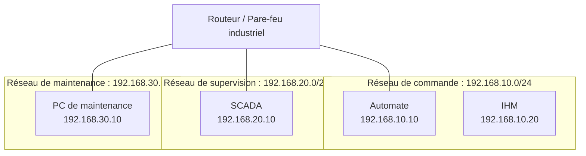
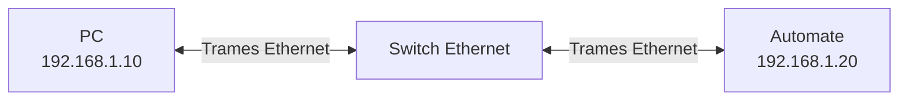
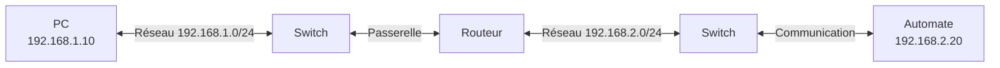
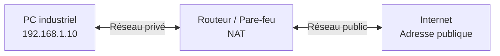

import Tabs from '@theme/Tabs';
import TabItem from '@theme/TabItem';

# Adressage IPv4 et communication réseau

Pour communiquer sur un réseau, chaque équipement doit pouvoir être identifié.
Une adresse IP permet d'identifier un équipement au niveau du réseau et de déterminer vers quel réseau les données doivent être acheminées.

IPv4 signifie *Internet Protocol version 4*.
Une adresse IPv4 est une valeur de **32 bits** permettant d'identifier une interface réseau dans un réseau IP.
Elle est généralement représentée sous la forme de quatre nombres décimaux séparés par des points.

Exemple :

```text
192.168.1.10
```

Chaque nombre représente un groupe de 8 bits appelé **octet**.
Une adresse IPv4 contient donc quatre octets.

Chaque octet peut prendre une valeur comprise entre 0 et 255.

```text
00000000 = 0
11111111 = 255
```

La valeur d'un octet est calculée à partir des puissances de 2.

| Position du bit | 7 | 6 | 5 | 4 | 3 | 2 | 1 | 0 |
|---|---:|---:|---:|---:|---:|---:|---:|---:|
| Valeur | 128 | 64 | 32 | 16 | 8 | 4 | 2 | 1 |

Dans l'adresse `192.168.1.10`, on constate que 

```text
192 = 128 + 64
```

Ce qui conduit à la conversion binaire

```text
192 = 11000000
```

De même pour le deuxième octet

```text
168 = 128 + 32 + 8
168 = 10101000
```

Au final, l'adresse `192.168.1.10` est convertie de la manière suivante : 

```text
Décimale  : 192       . 168       . 1         . 10
Binaire   : 11000000  . 10101000  . 00000001  . 00001010
# Données : 8 bits     8 bits      8 bits      8 bits
```

## Principe du masque de sous-réseau

Une adresse IPv4 contient deux informations logiques :

- Une partie qui identifie le réseau.
- Une partie qui identifie l'équipement dans ce réseau.

La séparation entre ces deux parties est définie via la donnée du **masque de sous-réseau**.
Ce masque est lui-même donné sous la forme de **32 bits**.
Prenons l'exemple suivant :

```text
Adresse IP : 192.168.1.10
Masque     : 255.255.255.0
```

Les adresses peuvent être converties sous forme binaire :

```text
Adresse IP :
    Décimale  : 192     .168     .1       .10
    Binaire   : 11000000.10101000.00000001.00001010

Masque :
    Décimale  : 255     .255     .255     .0
    Binaire   : 11111111.11111111.11111111.00000000
```

Le masque de sous-réseau permet de déterminer quelle partie d'une adresse IPv4 
correspond au réseau et quelle partie correspond à l'hôte : 

- Les bits à `1` correspondent à la partie réseau.
- Les bits à `0` correspondent à la partie hôte.

```text
Partie réseau              Partie hôte
11111111.11111111.11111111 | 00000000
```

Avec le masque `255.255.255.0`, les 24 premiers bits de l'adresse `192.168.1.10` 
identifient le réseau et les 8 derniers bits identifient l'hôte.

```text
Adresse IP : 192.168.1.10

             Partie réseau | Partie hôte
             192.168.1     | 10
```

### Notation CIDR

Au lieu d'écrire le masque complet, on utilise souvent une notation plus courte appelée notation CIDR.
CIDR signifie *Classless Inter-Domain Routing*.
On ajoute simplement `/` suivi du nombre de bits à 1 dans le masque.

```text
192.168.1.10 / 24
```

Cela signifie que les 24 premiers bits correspondent à la partie réseau.

Quelques correspondances courantes :

| Notation CIDR | Masque de sous-réseau | Bits réseau | Bits hôte |
|---|---|---:|---:|
| /8 | 255.0.0.0 | 8 | 24 |
| /16 | 255.255.0.0 | 16 | 16 |
| /24 | 255.255.255.0 | 24 | 8 |
| /25 | 255.255.255.128 | 25 | 7 |
| /26 | 255.255.255.192 | 26 | 6 |
| /27 | 255.255.255.224 | 27 | 5 |
| /28 | 255.255.255.240 | 28 | 4 |
| /30 | 255.255.255.252 | 30 | 2 |

:::warning Attention
Deux adresses IP qui commencent par les mêmes nombres ne sont pas nécessairement dans le même réseau.

Il faut toujours tenir compte du masque de sous-réseau pour déterminer la partie réseau et la partie hôte.
:::

## Calcul d'un réseau

Pour déterminer les caractéristiques d'un réseau IPv4, il faut connaître :

- Une adresse IP.
- Son masque de sous-réseau ou son préfixe CIDR.

On peut alors calculer :

1. L'adresse réseau.
2. L'adresse de broadcast.
3. La première adresse hôte utilisable.
4. La dernière adresse hôte utilisable.

### Adresse réseau

L'adresse réseau identifie un sous-réseau.

Elle est obtenue en effectuant un ET logique (AND) entre l'adresse IP et le masque.

Exemple :

```text
Adresse IP : 192.168.1.10
Masque     : 255.255.255.0
```

Résultat :

```text
Adresse réseau : 192.168.1.0
```

Dans ce réseau, tous les équipements possèdent les trois premiers octets identiques.

### Adresse de broadcast

L'adresse de broadcast permet d'envoyer un message à tous les équipements d'un sous-réseau IPv4.

Dans le cas d'un réseau `/24` :

```text
Adresse réseau   : 192.168.1.0
Adresse broadcast: 192.168.1.255
```

Les bits de la partie hôte sont tous à `1` pour l'adresse de broadcast.

### Première et dernière adresse utilisables

Dans un sous-réseau IPv4 classique, les adresses situées entre l'adresse réseau et l'adresse de broadcast peuvent être attribuées aux interfaces des équipements.

Pour notre exemple :

| Élément | Adresse |
|---|---|
| Adresse réseau | 192.168.1.0 |
| Première adresse utilisable | 192.168.1.1 |
| Dernière adresse utilisable | 192.168.1.254 |
| Adresse de broadcast | 192.168.1.255 |

:::info Attention
L'adresse réseau et l'adresse de broadcast ne sont normalement pas attribuées aux équipements dans un sous-réseau IPv4 classique.

Il existe des cas particuliers, notamment les réseaux `/31` utilisés pour certaines liaisons point-à-point.
Ils ne seront pas abordés dans le cadre de cette introduction.
:::

### Exemple de calcul avec un préfixe /26

Considérons :

```text
Adresse IP : 192.168.1.70
Masque     : 255.255.255.192
Préfixe    : /26
```

Le masque `/26` signifie :

- 26 bits pour le réseau.
- 6 bits pour les hôtes.

Le dernier octet du masque vaut `192`.

En binaire, comme `192 = 128 + 64` :

```text
192 = 11000000
```

Les sous-réseaux progressent donc par blocs de :

```text
256 - 192 = 64
```

Les différents sous-réseaux sont :

| Sous-réseau | Adresse réseau (décimal) | Dernier octet binaire (Réseau / Broadcast) | Adresse broadcast |
|---|---|---|---|
| 1 | 192.168.1.0 | `00`000000 / `00`111111 | 192.168.1.63 |
| 2 | 192.168.1.64 | `01`000000 / `01`111111 | 192.168.1.127 |
| 3 | 192.168.1.128 | `10`000000 / `10`111111 | 192.168.1.191 |
| 4 | 192.168.1.192 | `11`000000 / `11`111111 | 192.168.1.255 |


L'adresse `192.168.1.70` appartient donc au deuxième sous-réseau.

Résultat :

| Élément | Adresse |
|---|---|
| Adresse IP | 192.168.1.70 |
| Masque | 255.255.255.192 |
| Adresse réseau | 192.168.1.64 |
| Première adresse utilisable | 192.168.1.65 |
| Dernière adresse utilisable | 192.168.1.126 |
| Adresse broadcast | 192.168.1.127 |

:::tip Méthode de calcul
Pour les masques dont le dernier octet est différent de 255 ou 0, on peut utiliser la taille du bloc :

`Taille du bloc = 256 - valeur de l'octet du masque`

On cherche ensuite dans quel intervalle se situe l'adresse IP.

Dans notre exemple, les blocs ont une taille de 64 :

- 0 à 63
- 64 à 127
- 128 à 191
- 192 à 255

L'adresse 70 appartient donc au bloc 64 à 127.
:::

## Détermination du nombre d'hôtes

Le nombre d'adresses disponibles dans un sous-réseau dépend du nombre de bits réservés à la partie hôte.
La formule générale est :

```text
Nombre d'adresses = 2^n
```

Avec `n` le nombre de bits réservés aux hôtes.

Dans un sous-réseau IPv4 classique, deux adresses sont réservées :

- L'adresse réseau.
- L'adresse de broadcast.

Le nombre d'adresses hôtes utilisables devient :

```text
Nombre d'hôtes utilisables = 2^n - 2
```

### Exemples

| Préfixe | Bits hôte | Nombre de sous-réseaux | Nombre total d'adresses | Hôtes utilisables |
|---|---:|---:|---:|---:|
| /24 | 8 | 1 | 256 | 254 |
| /25 | 7 | 2 | 128 | 126 |
| /26 | 6 | 4 | 64 | 62 |
| /27 | 5 | 8 | 32 | 30 |
| /28 | 4 | 16 | 16 | 14 |
| /29 | 3 | 32 | 8 | 6 |
| /30 | 2 | 64 | 4 | 2 |

### Exemple de dimensionnement

Une petite installation industrielle comprend :

- 1 automate.
- 1 IHM.
- 1 PC de maintenance.
- 1 serveur industriel.
- 1 interface réseau de routeur.

Cela représente 5 interfaces à adresser.

Un réseau `/29` offre 6 adresses hôtes utilisables.

Il est donc suffisant pour cet exemple, mais laisse peu de marge pour une évolution future.

Un réseau `/28` offre 14 adresses hôtes utilisables et permet davantage d'évolutions.

:::tip À retenir
Plus le préfixe CIDR est grand, plus la partie réseau est importante et moins il reste de bits pour les hôtes.

Par exemple :

- `/24` offre 254 hôtes utilisables.
- `/26` offre 62 hôtes utilisables.
- `/28` offre 14 hôtes utilisables.
:::

---

## Exemples de sous-réseaux industriels

Dans une installation industrielle, il est souvent utile de séparer les équipements en plusieurs sous-réseaux.

Cette séparation facilite l'organisation du réseau et peut contribuer à améliorer sa sécurité.

Considérons une installation composée de trois zones :

- Un réseau de commande.
- Un réseau de supervision.
- Un réseau de maintenance.

On peut utiliser le plan d'adressage suivant :

| Zone | Adresse réseau | Masque | Exemple d'équipement |
|---|---|---|---|
| Commande | 192.168.10.0/24 | 255.255.255.0 | Automate : 192.168.10.10 |
| Supervision | 192.168.20.0/24 | 255.255.255.0 | SCADA : 192.168.20.10 |
| Maintenance | 192.168.30.0/24 | 255.255.255.0 | PC : 192.168.30.10 |

Représentation simplifiée :



Dans cet exemple, les trois réseaux sont distincts.

Les équipements d'un même sous-réseau peuvent communiquer directement au niveau IP.

Pour communiquer entre les différents sous-réseaux, ils doivent passer par un équipement de niveau 3, comme un routeur ou un pare-feu configuré pour assurer le routage.

:::warning Important
Utiliser plusieurs sous-réseaux ne garantit pas automatiquement une séparation sécurisée.

Il faut également définir les règles de communication autorisées entre ces réseaux. Cette notion sera approfondie lors de la séance consacrée à la cybersécurité industrielle.
:::

---

## Communication dans le même réseau

Lorsque deux équipements appartiennent au même sous-réseau IP, ils peuvent communiquer directement au niveau IP, sans passer par un routeur.

Exemple :

| Équipement | Adresse IP | Masque |
|---|---|---|
| PC de maintenance | 192.168.1.10 | 255.255.255.0 |
| Automate | 192.168.1.20 | 255.255.255.0 |

Les deux équipements appartiennent au réseau :

```text
192.168.1.0/24
```

Ils peuvent donc communiquer directement.

### Fonctionnement simplifié

Supposons que le PC souhaite envoyer des données à l'automate.

1. Le PC compare les adresses IP à l'aide de son masque.
2. Il détermine que l'automate appartient au même sous-réseau.
3. Il doit connaître l'adresse MAC de l'automate.
4. Si cette adresse est inconnue, il utilise ARP pour la découvrir.
5. Il envoie ensuite une trame Ethernet directement à l'adresse MAC de l'automate.



:::info Rôle d'ARP
ARP (*Address Resolution Protocol*) permet de retrouver l'adresse MAC correspondant à une adresse IPv4 sur le réseau local.

Par exemple, le PC connaît l'adresse IP `192.168.1.20`, mais doit découvrir l'adresse MAC de l'automate pour lui envoyer une trame Ethernet.
:::

---

## Communication vers un autre réseau

Lorsque deux équipements appartiennent à des sous-réseaux différents, ils ne peuvent pas communiquer directement au niveau IP sur leur réseau local.

Ils doivent utiliser un routeur pour transmettre les paquets vers le réseau de destination.

Exemple :

| Équipement | Adresse IP | Masque |
|---|---|---|
| PC de maintenance | 192.168.1.10 | 255.255.255.0 |
| Automate | 192.168.2.20 | 255.255.255.0 |

Le PC appartient au réseau :

```text
192.168.1.0/24
```

L'automate appartient au réseau :

```text
192.168.2.0/24
```

Ces deux équipements ne sont donc pas dans le même sous-réseau.

### Fonctionnement simplifié

1. Le PC souhaite communiquer avec l'automate.
2. Il compare les adresses IP et détermine que l'automate appartient à un autre réseau.
3. Il transmet le paquet à sa passerelle par défaut.
4. Le routeur reçoit le paquet et consulte sa table de routage.
5. Il transmet le paquet vers le réseau de destination.



:::info À retenir
Lorsqu'une destination appartient à un autre sous-réseau, l'équipement envoie le paquet à sa passerelle par défaut.

La passerelle est généralement l'interface d'un routeur présente dans le sous-réseau local.
:::

## Rôle du routeur

Un routeur est un équipement réseau permettant de faire communiquer plusieurs réseaux IP.

Contrairement à un switch Ethernet classique, qui transmet les trames dans un réseau local en utilisant les adresses MAC, le routeur prend ses décisions de transfert à partir des adresses IP.

### Exemple de configuration

Considérons un routeur connecté à deux réseaux :

| Interface du routeur | Adresse IP | Réseau |
|---|---|---|
| Interface 1 | 192.168.1.1/24 | 192.168.1.0/24 |
| Interface 2 | 192.168.2.1/24 | 192.168.2.0/24 |

Chaque réseau utilise l'adresse de l'interface du routeur comme passerelle par défaut.

| Équipement | Adresse IP | Passerelle |
|---|---|---|
| PC de maintenance | 192.168.1.10/24 | 192.168.1.1 |
| Automate | 192.168.2.20/24 | 192.168.2.1 |

Le PC peut ainsi communiquer avec l'automate en passant par le routeur.

### Rôle de la passerelle par défaut

La passerelle par défaut est l'adresse IP du routeur que l'équipement utilise lorsqu'il souhaite communiquer avec une destination située hors de son sous-réseau.

Sans passerelle correctement configurée, un équipement peut communiquer avec les équipements de son réseau local, mais ne pourra généralement pas joindre les autres réseaux IP.

:::warning Erreur fréquente
La passerelle par défaut doit appartenir au même sous-réseau IP que l'équipement qui l'utilise.

Par exemple, un PC configuré avec :

- Adresse IP : `192.168.1.10`
- Masque : `255.255.255.0`

peut utiliser `192.168.1.1` comme passerelle.

Il ne peut pas utiliser directement `192.168.2.1` comme passerelle sur cette interface.
:::

### Switch ou routeur ?

| Équipement | Fonction principale | Informations utilisées |
|---|---|---|
| Switch Ethernet classique | Connecter des équipements dans un réseau local | Adresse MAC |
| Routeur | Faire communiquer plusieurs réseaux IP | Adresse IP |

Un switch de niveau 3 peut également assurer des fonctions de routage.


:::tip Les trois questions à se poser
Pour analyser une configuration IPv4, il faut toujours se poser trois questions :

1. Quelle est l'adresse IP de l'équipement ?
2. Quel est son masque de sous-réseau ?
3. Quelle est sa passerelle par défaut ?

Ces trois informations permettent déjà de comprendre une grande partie de son comportement réseau.
:::

## Adresses privées et publiques

Toutes les adresses IPv4 ne sont pas destinées à être utilisées de la même manière.
On distingue notamment les adresses privées et les adresses publiques.

Les adresses privées sont réservées aux réseaux locaux.
Elles sont utilisées dans les réseaux domestiques, les entreprises et les installations industrielles.

Trois plages sont réservées à cet usage :

| Plage d'adresses | Préfixe CIDR | Taille |
|---|---|---:|
| 10.0.0.0 à 10.255.255.255 | 10.0.0.0/8 | Très grande |
| 172.16.0.0 à 172.31.255.255 | 172.16.0.0/12 | Moyenne |
| 192.168.0.0 à 192.168.255.255 | 192.168.0.0/16 | Plus petite |

Exemples :

- `192.168.1.10` : adresse privée.
- `10.20.5.15` : adresse privée.
- `172.20.1.100` : adresse privée.

Ces adresses peuvent être utilisées librement dans des réseaux privés, à condition d'éviter les conflits d'adressage entre réseaux qui doivent communiquer.

Les adresses publiques sont utilisées pour identifier des interfaces sur Internet.

Elles sont attribuées selon les règles de gestion des adresses IP et doivent être uniques à l'échelle de l'Internet public.

Exemple :

```text
1.1.1.1
```

### Communication entre réseau privé et Internet

Un équipement possédant une adresse privée ne communique généralement pas directement avec Internet.

Un routeur ou un pare-feu réalise souvent une traduction d'adresses appelée NAT (*Network Address Translation*).

Exemple :



:::info À retenir
Les adresses privées sont utilisées dans les réseaux locaux.

Les adresses publiques permettent notamment d'identifier les équipements ou interfaces accessibles sur Internet.

Le NAT permet notamment à plusieurs équipements possédant des adresses privées de partager une adresse IPv4 publique.
:::