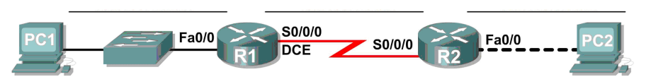

import Tabs from '@theme/Tabs';
import TabItem from '@theme/TabItem';

# Adressage IPv4

## Calcul d'adressage

Pour chacun des problèmes, complétez la fiche.
Présentez les calculs nécessaires, notamment le calcul de l'adresse réseau et celui des limites du sous-réseau.

### Fiche de calcul à compléter

Pour chaque problème, indiquez :

| Information à déterminer | Réponse |
|---|---|
| Adresse IP donnée | |
| Masque fourni (décimal et préfixe) | |
| Nombre de bits d'hôte (`32 - préfixe`) | |
| Nombre d'hôtes utilisables (`2^bits hôte - 2`) | |
| Adresse du sous-réseau | |
| Première adresse hôte utilisable | |
| Dernière adresse hôte utilisable | |
| Adresse de diffusion | |
<!-- | Masque du réseau de départ retenu | |
| Nombre de bits empruntés | |
| Nombre de sous-réseaux (`2^bits empruntés`) | | -->

### Problème 1

- Adresse IP : `172.30.1.33`
- Masque : `255.255.255.0`

Complétez une fiche de calcul.

### Problème 2

- Adresse IP : `172.30.1.33`
- Masque : `255.255.255.252`

Complétez une fiche de calcul.

:::warning Vérification particulière
Vérifiez si l'adresse IP fournie est réellement une adresse hôte utilisable dans le sous-réseau obtenu. Une adresse peut appartenir à un sous-réseau tout en étant son adresse réseau ou son adresse de diffusion.
:::

### Problème 3

- Adresse IP : `192.192.10.234`
- Masque : `255.255.255.0`

Complétez une fiche de calcul.

### Problème 4

- Adresse IP : `172.17.99.71`
- Masque : `255.255.0.0`

Complétez une fiche de calcul.

### Problème 5

- Adresse IP : `192.168.3.219`
- Masque : `255.255.255.0`

Complétez une fiche de calcul.

### Problème 6

- Adresse IP : `192.168.3.219`
- Masque : `255.255.255.252`

Complétez une fiche de calcul.

:::warning Vérification particulière
Comme pour le problème 2, vérifiez si l'adresse fournie est une adresse hôte utilisable ou une adresse réservée du sous-réseau.
:::

## Conception d'un plan d'adressage IPv4

Une petite entreprise possède le bloc d'adresses `192.168.1.0/24`. Elle souhaite mettre en place deux réseaux locaux reliés par deux routeurs.
Le réseau local de R1 doit accueillir 15 hôtes. Celui de R2 doit accueillir 30 hôtes. Une liaison relie directement les deux routeurs.
Le schéma ci-dessous représente les trois segments IP à adresser. Les détails physiques (type de câble, port exact du PC) ne sont pas nécessaires pour cette activité.



<!-- ```mermaid
flowchart LR
    PC1["PC1"] --- LAN1["LAN de R1"]
    LAN1 --- R1["Routeur R1"]
    R1 ---|"Liaison inter-routeurs"| R2["Routeur R2"]
    R2 --- LAN2["LAN de R2"]
    LAN2 --- PC2["PC2"]
``` -->

### Tâche 1 - Découper le bloc d'adresses

Le bloc disponible est `192.168.1.0/24`.
Les segments à adresser sont :

| Segment | Besoin |
|---|---:|
| LAN connecté à R1 | 15 hôtes |
| LAN connecté à R2 | 30 hôtes |
| Liaison entre R1 et R2 | 2 interfaces, une à chaque extrémité |
| **Total** | **3 sous-réseaux** |

Le cahier des charges impose des sous-réseaux **de taille égale**. 

Répondez aux questions :

1. Combien de sous-réseaux faut-il prévoir ?
2. Combien de bits doivent rester pour les hôtes afin de disposer d'au moins 30 adresses hôtes utilisables ?
3. Quel est le préfixe CIDR correspondant ?
4. Quel est le masque en notation décimale pointée ?
5. Combien d'adresses totales et d'adresses hôtes utilisables contient chaque sous-réseau ?
6. Combien de sous-réseaux de cette taille peut-on obtenir dans le bloc `/24` ?

Respectez impérativement les affectations suivantes :

1. Le **deuxième sous-réseau** est attribué au LAN de R1.
2. Le **troisième sous-réseau** est attribué à la liaison entre R1 et R2.
3. Le **quatrième sous-réseau** est attribué au LAN de R2.

Complétez le tableau :

| Segment | Adresse réseau / préfixe | Première adresse hôte | Dernière adresse hôte | Diffusion |
|---|---|---|---|---|
| 1er sous-réseau (non attribué) | | | | |
| LAN R1 (2e sous-réseau) | | | | |
| Liaison R1–R2 (3e sous-réseau) | | | | |
| LAN R2 (4e sous-réseau) | | | | |

### Tâche 2 - Attribuer les adresses aux interfaces

Appliquez les consignes suivantes :

1. Attribuez la première adresse hôte utilisable du deuxième sous-réseau à l'interface LAN de R1.
2. Attribuez la dernière adresse hôte utilisable du deuxième sous-réseau à PC1.
3. Attribuez la première adresse hôte utilisable du troisième sous-réseau à l'interface série de R1.
4. Attribuez la dernière adresse hôte utilisable du troisième sous-réseau à l'interface série de R2.
5. Attribuez la première adresse hôte utilisable du quatrième sous-réseau à l'interface LAN de R2.
6. Attribuez la dernière adresse hôte utilisable du quatrième sous-réseau à PC2.

<!-- :::warning Correction d'une incohérence dans l'énoncé d'origine
Le document Cisco attribue PC1 à la dernière adresse hôte du « troisième sous-réseau », alors que ce troisième sous-réseau est simultanément réservé à la liaison série R1–R2. Ces deux affectations se contredisent.

Dans cette version, PC1 reçoit donc la dernière adresse hôte du **deuxième sous-réseau**, c'est-à-dire le LAN de R1. Cette correction permet de conserver les trois segments et les affectations des routeurs sans chevauchement.
::: -->

#### Tableau d'adressage à compléter

| Équipement | Interface | Adresse IP / préfixe | Masque | Passerelle par défaut |
|---|---|---|---|---|
| R1 | Interface LAN | | | Sans objet |
| R1 | Interface série vers R2 | | | Sans objet |
| R2 | Interface LAN | | | Sans objet |
| R2 | Interface série vers R1 | | | Sans objet |
| PC1 | Carte réseau | | | |
| PC2 | Carte réseau | | | |

Pour les PC, la passerelle par défaut est l'adresse de l'interface LAN du routeur présent sur le même sous-réseau.

<!-- ### Tâche 4 - Comprendre les limites de la connectivité

1. PC1 peut-il communiquer avec sa passerelle sans qu'un routage entre les deux routeurs soit nécessaire ? Expliquez.
2. PC2 peut-il communiquer avec sa passerelle sans qu'un routage entre les deux routeurs soit nécessaire ? Expliquez.
3. Les routeurs peuvent-ils communiquer directement sur leur liaison série si les interfaces sont correctement adressées et activées ?
4. PC1 peut-il communiquer avec PC2 uniquement grâce aux adresses IP attribuées aux interfaces ?
5. Quel mécanisme faut-il ajouter pour permettre aux deux LAN de communiquer ?

:::tip À retenir
Une adresse IP correcte ne suffit pas à assurer la communication entre des réseaux différents. Les routeurs doivent aussi disposer d'une information de routage vers les réseaux distants (routes statiques ou protocole de routage).
::: -->